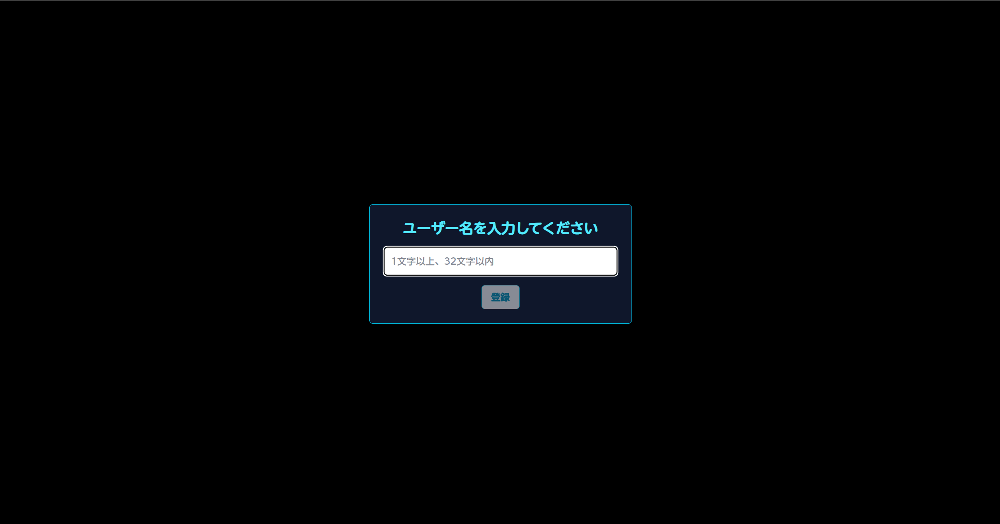
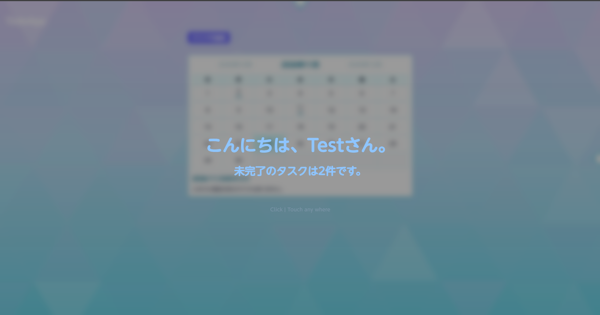
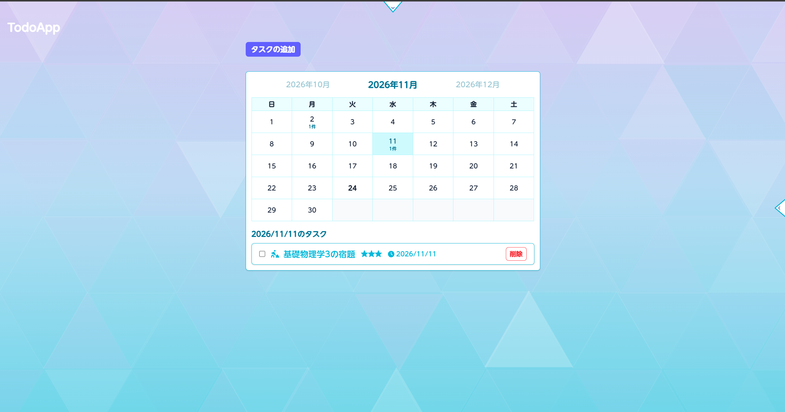
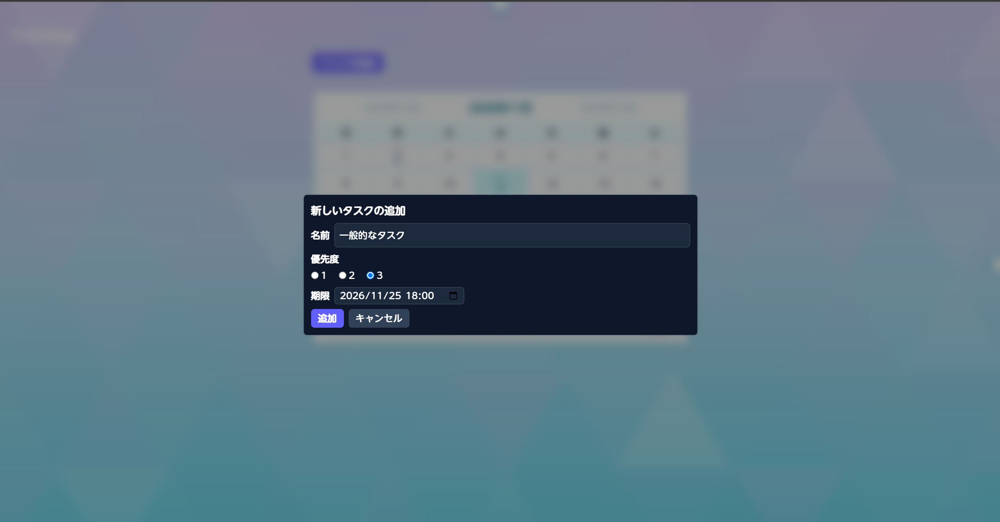
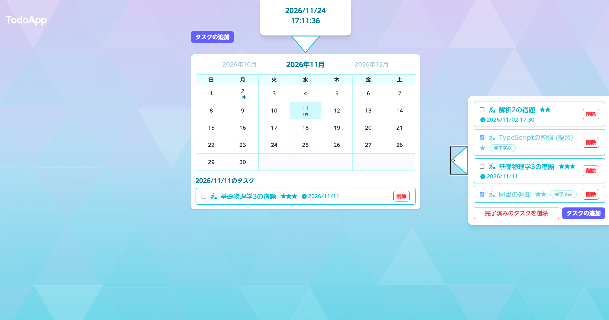

# カレンダー型Todoアプリ

リンク: https://he1lgato.github.io/react-todo-app/

React、TypeScript、Tailwind CSS を使用し、ローカルストレージでデータを永続化した「Todoアプリ」です。

## 使用方法

上記のリンクにアクセスすると名前の入力を求められるため，条件に従った名前を入力してください．

名前の入力後，または起動時には，ウェルカムメッセージおよび未完了タスクの件数が表示されます．任意の場所をクリック・タップすることで，Todoの画面に切り替わります．

Todo画面は中央にカレンダーが表示されており，起動時には現在の日にちが選択されています．特定の日にちをクリックすることで，その日が期限であるタスクの一覧が表示されます．

タスク名の左にあるチェックボックスをクリックすると，タスクを完了状態にすることができ，右にある**削除**ボタンをクリックすることで，タスクを削除することができます．

また，カレンダー上部にある，半透明で表示されている月をクリックすることで，表示する月を変更することができます．

カレンダーの上にある**タスクの追加**ボタンをクリックすると，タスクの追加画面が表示されます．

ここでは，追加するタスクの名前，優先度，期限を設定することができます．期限を設定せずにタスクを追加することもできますが，そのタスクはカレンダーには表示されません．

画面右端にある出っ張りをクリックすると，設定されている全てのタスクが表示されます．ここでは，先ほど説明したタスクの完了・未完了の変更，削除，追加だけでなく，完了済みのタスクを全て削除することができます．

また，画面上端にある出っ張りをクリックすると，現在の日時が表示されます．

## 開発履歴

- 2026年10月16日：プロジェクト開始
- 11月21日：ver1完成

開発期間：20時間
